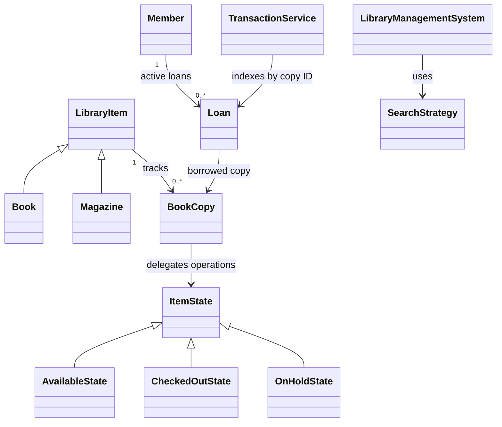

# OOD sample: Library Management System

This is a reading guide to a published Python interview solution, not a new solution invented for this conversation. The accompanying implementation is copied unchanged from **Ashish Pratap Singh and contributors' awesome-low-level-design repository**, at commit `31595db8c21a8f7785b2ef45d90f16fd8053abad`. Retrieved September 29, 2026.

The source is useful for studying object collaboration, State, Strategy, and Observer. It is a teaching implementation with limitations, documented below; it is not a complete implementation of every requirement in its README.

## Sources and local files

- [Published problem and requirements](https://github.com/ashishps1/awesome-low-level-design/blob/31595db8c21a8f7785b2ef45d90f16fd8053abad/problems/library-management-system.md)
- [Published Python solution](https://github.com/ashishps1/awesome-low-level-design/tree/31595db8c21a8f7785b2ef45d90f16fd8053abad/solutions/python/librarymanagementsystem)
- [Local source directory](library_management_source/), including the original [problem](library_management_source/PROBLEM.md), [README](library_management_source/README.md), and [GPL v3 license](library_management_source/LICENSE).
- [Educative: library-system class design](https://www.educative.io/courses/grokking-the-low-level-design-interview-using-ood-principles/class-diagram-for-the-library-management-system). Its public preview distinguishes book metadata from individual book items.
- [Educative: library-system implementation lesson](https://www.educative.io/courses/grokking-the-low-level-design-interview-using-ood-principles/code-of-library-management-system). The preview lists Python among the implementation languages. The full code was not available in the public page retrieved; the local code comes from the GitHub source above, not Educative.
- [Packt: Python Object-Oriented Programming, Fourth Edition, official companion repository](https://github.com/PacktPublishing/Python-Object-Oriented-Programming---4th-edition). For foundations, its chapter outline covers object-oriented design, Python objects, inheritance, exceptions, and when to use OOP. This is a separate textbook resource, not the source of this library implementation.

All explanatory tracing, complexity analysis, and review observations below are editorial annotations based on the downloaded code. They are not quotations or claims of an official Amazon answer.

## Run the published solution

From the workspace root:

```bash
python -B coding/ood/library_management_source/library_management_system_demo.py
```

The demo uses the Python standard library. It creates books and a magazine, searches the catalog, borrows and returns copies, and demonstrates a hold notification.

## Sample question and implemented scope

Design a library system that manages catalog items, their physical copies, members, and loans. Support searching by title or author, checkout, return, and holds on checked-out items.

The upstream problem additionally requests borrowing limits, loan duration, catalog updates/removals, and concurrency. Those requirements are not fully implemented in the Python example. Treat them as follow-up work, not completed features.

## Read the classes in this order

| Order | Class / file | Responsibility in the published implementation |
| --- | --- | --- |
| 1 | [LibraryItem](library_management_source/library_item.py), [Book](library_management_source/book.py), [Magazine](library_management_source/magazine.py) | Shared title-level information; subclasses supply author or publisher information. The item also keeps copies and hold observers. |
| 2 | [BookCopy](library_management_source/book_copy.py) | A separately identifiable physical copy, linked to its catalog item and current state. |
| 3 | [Member](library_management_source/member.py) | Member identity, active loan list, and notification callback. |
| 4 | [Loan](library_management_source/loan.py) | Connect a member to a copy and record the checkout date. |
| 5 | [TransactionService](library_management_source/transaction_service.py) | Maintain the copy-to-active-loan mapping and update the member's loan list. |
| 6 | [ItemState implementations](library_management_source/item_states.py) | Decide whether checkout, return, and holds are permitted for the copy's current state. |
| 7 | [SearchStrategy implementations](library_management_source/search_strategy.py) | Interchangeable title and author searches. |
| 8 | [LibraryManagementSystem](library_management_source/library_management_system.py) | Public entry point coordinating catalog, member, and copy lookup. |
| 9 | [Demo](library_management_source/library_management_system_demo.py) | Show the objects collaborating through concrete scenarios. |

The distinction is between a title such as *Dune* and a physical copy such as `B002-c1`. Separate copies can have separate borrowing states.



## Trace a successful checkout

Follow `library.checkout(member_id, copy_id)`:

1. `LibraryManagementSystem` looks up the member and physical copy in dictionaries.
2. It calls `BookCopy.checkout(member)`.
3. The copy delegates to its current state's `checkout()` method.
4. `AvailableState` asks `TransactionService` to create a loan.
5. The service rejects an existing active loan for that copy, creates a `Loan`, indexes it by copy ID, and appends it to `member.loans`.
6. The copy transitions to `CheckedOutState`.

The state object's implementation determines allowed behavior. `CheckedOutState.checkout()` rejects another checkout by printing a message rather than creating a second loan.

## Trace a return and hold

1. `LibraryManagementSystem.return_item(copy_id)` locates the copy.
2. `BookCopy` delegates to its current state.
3. `CheckedOutState` ends the loan through `TransactionService`.
4. The service removes the active-loan entry and the loan from the borrower's list.
5. With no waiting observers, the copy becomes available.
6. With waiting observers, it becomes on hold and notifies the item's observers.
7. `OnHoldState` permits checkout by a member in that observer list; it removes that observer after creating the loan.

This implements membership-based hold eligibility, not a FIFO reservation queue. The return method accepts only a copy ID; it does not authenticate the person returning it.

## What this source says about our earlier questions

### Does borrowing data belong in Member?

In this published example, **yes**: `Member.loans` contains the member's active loans. `TransactionService.active_loans` provides a separate lookup by physical copy ID. Both reference the same loan objects.

The member count can be obtained with `len(member.get_loans())`, which is O(1). No separate integer count is necessary. The actual implementation uses a **list**, not the set discussed earlier. Returning a loan therefore includes a linear search/removal.

### Is the dictionary a database index?

It is an in-memory lookup structure. It maps copy IDs directly to `Loan` objects. There is no database in this implementation, so it does not establish database transaction, persistence, or concurrency semantics.

### Does every failure raise an exception?

No. This source mixes printed rejection messages with exceptions. For example, the state classes print messages for invalid operations, while `TransactionService.create_loan()` raises `ValueError` if the copy already has an active loan. This is an observable property of this example, not a recommendation that every interview solution use that mixed contract.

## Actual complexity of this implementation

Let `k` be a member's active loans, `c` the copies of one item, `h` its hold observers, and `n` the catalog items. Assume bounded-size identifiers and metadata for the table, ordinary hash behavior, and exclude printing costs.

| Operation | Complexity | Reason |
| --- | --- | --- |
| Member/copy lookup | Expected O(1) | Dictionary lookup |
| Checkout of an available copy | Expected amortized O(1) | Dictionary insertion plus list append |
| Count member loans | O(1) | List length |
| Return with no holds | Expected O(k) | Search and removal from member's loan list |
| Return with hold notifications | Expected O(k + h) | Loan removal plus notifying observers |
| Checkout of an on-hold copy | Expected amortized O(h + 1) | Observer membership test and list removal |
| Count available copies of an item | O(c) | Scans the item's copies |
| Find a copy for placing a hold | O(c) worst case | Scans for a nonavailable copy |
| Title/author search | O(n), with bounded string lengths | Scans catalog; real cost also includes string matching |

Amortized bounds account for occasional list or dictionary resizing. Expected bounds account for hash-table behavior. Neither means every individual operation is guaranteed constant time.

An optional optimization exercise, **not present upstream**, is to index a member's active loans by copy ID rather than keeping a list. This can make removal expected O(1). Both indexes must still be updated consistently.

## Limitations to recognize before using this as an interview reference

These are findings from inspecting the Python source, not additional author claims:

- **README drift:** the README mentions `LibraryManager` and Java's `ConcurrentHashMap`, but the Python code uses `LibraryManagementSystem` and ordinary dictionaries. Follow the code when tracing behavior.
- **Missing rules:** no maximum-loan enforcement, due dates, overdue fees, or retained completed-loan history. Returning deletes the active record.
- **No transaction-level locking:** the singleton accessors and multi-step state changes do not make concurrent operations safe.
- **Duplicate IDs:** adding an existing item/member ID overwrites dictionary entries and can leave earlier references inconsistent.
- **Simplified holds:** observers are stored at title level, eligibility is not FIFO, duplicates are possible, and multi-copy reservation behavior is incomplete.
- **Mutable internals:** getters expose live lists, so callers can bypass coordination and invalidate state.
- **Mixed error reporting:** some invalid requests print messages; others raise exceptions. A caller cannot uniformly distinguish success from failure through return values.
- **Singleton coupling:** services use process-global instances, making independent library instances and isolated tests harder.

It is a useful published example of OOD patterns and sequential workflows, but it should not be presented as a fully correct implementation of every upstream requirement. In particular, patterns alone do not establish correctness.

## Suggested study exercise

First run the original demo. Then trace one checkout and return across the source files without changing code. Explain why `BookCopy`, `Member`, and `Loan` are distinct objects, where duplicate-checkout rejection occurs, and which updates must agree.

Only after that, consider a follow-up such as a borrowing limit or faster member-loan removal. Label any modifications as your extension rather than part of the published solution.

## Verification performed

The original demo completed successfully. Additional in-memory assertions passed for checkout, independent copies, duplicate-checkout rejection, loan removal on return, hold eligibility, repeated return, and case-insensitive title search. These were sequential checks; they do not establish concurrency safety or cover the missing requirements above.

The 13 upstream Python files, original README, problem statement, and license are saved unchanged. No third-party package installation was required.
